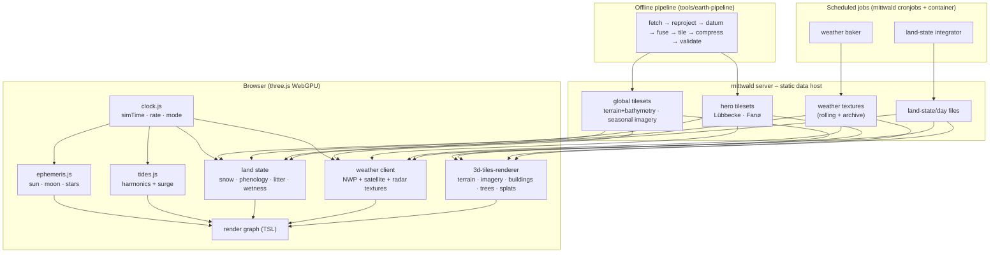

# 01 · Architecture – engine, precision, streaming, frame

[← back to the plan index](README.md)

Facts below were checked in October 2026 (npm, GitHub, vendor pages). **(✓)** verified,
**(~)** secondary / own estimate.

---

## 1. Engine decision

### 1.1 Recommendation

**three.js (r187+) `WebGPURenderer` + TSL**, with its automatic WebGL2 fallback, plus
**`3d-tiles-renderer`** (NASA-AMMOS, Apache-2.0) for streaming, plus
**`@takram/three-atmosphere/webgpu`** (MIT) for the sky, plus **our own TSL passes** for
clouds, ocean, tides, vegetation and snow.

Why:

- The app already is three.js (r185) – every other simulation, the UI kit, `createScene()`.
  `createScene()` builds a `WebGLRenderer` (`src/lib/scene.js`), so the earth sim creates
  its own `WebGPURenderer` (or `createScene()` gains a renderer option); the UI kit is used
  unchanged.
- WebGPU compute is needed for the FFT ocean, the local shallow-water window, cloud
  noise baking, GPU-driven vegetation culling and snow deformation. CesiumJS (1.146,
  Apache-2.0, the most complete 3D Tiles engine) has **no WebGPU/compute**; iTowns and
  Giro3D are WebGL-only wrappers around three.js + 3d-tiles-renderer; deck.gl's WebGPU is
  experimental; MapLibre is a map camera, not a world renderer. (✓)
- WebGPU is available by default in Chrome/Edge (desktop since 113, Android 12+ since
  121), **Safari 26** (macOS/iOS/iPadOS/visionOS) and Firefox (Windows 141, macOS Apple
  Silicon 145); Linux is partial. Devices without it get the WebGL2 backend. (✓)

### 1.2 Versions and what they bring (✓)

| Package | Version (Oct 2026) | Notes |
|---|---|---|
| `three` | **0.187.0** (r187, 30 Oct 2026); r186 24 Sep | r186: native `GaussianSplat` (WebGPU compute sort, SPZ v4, glTF splat extension), `batchIndirectIndex`, `compileComputeAsync()`, `SunLight` with cascaded shadow maps; r187: parallel pipeline compile, merged BatchedMesh draws, `webgpu_meshlets_*` examples. **Upgrade the repo from r185 to r187 first.** |
| `3d-tiles-renderer` | 0.5.3 | TilesRenderer, GlobeControls, EnvironmentControls, Ellipsoid, implicit tiling, glTF extensions (KTX2, meshopt, Draco, `EXT_mesh_features`, `EXT_structural_metadata`), QuantizedMesh / Terrarium mesh plugins, ImageOverlay (XYZ/TMS/WMTS/WMS/PMTiles…), TileFlattening, LoadRegion, Google & Cesium ion auth plugins |
| `@takram/three-atmosphere` | 0.19.1 | `/webgpu` export done (three ≥ 0.182) |
| `@takram/three-geospatial` | 0.9.1 | core, `/webgpu` export |
| `@takram/three-clouds` | 0.7.6 | **WebGL only** → template for our TSL clouds |
| `@pmndrs/sky` | 0.6.0 | alternative Hillaire-2020 sky, WebGPU, three ≥ 0.186 |
| `@dgreenheck/ez-tree` | 1.1.0 | procedural trees (MIT) |
| `astronomy-engine` | 2.1.19 | ephemerides (MIT) |

### 1.3 Known gaps and how to close them

| Gap | Fix |
|---|---|
| 3d-tiles-renderer plugins that patch shaders (`ImageOverlayPlugin`, `TilesFadePlugin`, `BatchedTilesPlugin`, TopoLines) use `onBeforeCompile`/`ShaderMaterial` → **fail on WebGPU** (issue #1380; maintainer: WebGPU "not a priority") | Port them to TSL starting from **takram's MIT TSL ports** (`storybook-webgpu/src/plugins/`: ImageOverlay, TilesFade, WaterAreaOverlay) and upstream them |
| `renderer.highPrecision` (CPU 64-bit modelView) is **not compatible with InstancedMesh** | floating origin (§3) instead – keeps instanced trees precise |
| WebGL2 fallback runs "compute" as transform feedback: no workgroup memory, atomics or storage textures | FFT ocean / cloud noise / SWE get fragment-shader ping-pong fallbacks or precomputed textures on the WebGL2 tier |
| `@takram/three-clouds` is WebGL-only, ≤ 4 layers, weather texture is a repeating tile | own TSL raymarcher with geo-referenced weather textures ([08](08-atmosphere-weather-clouds.md#4-clouds-rendering)) |
| takram repo has one maintainer and was quiet for ~5 months | thin adapter around the atmosphere so `@pmndrs/sky` can replace it |
| Tile cache is a hard LRU cap (default 0.3–0.4 GB): when full, refinement stops | per-tier budgets (§5), separate caches for hero tilesets |

### 1.4 Fallback architecture

**Go/no-go at the end of M0.** The critical path is imagery draped on streamed terrain,
which needs `ImageOverlayPlugin` – one of the plugins that fail on WebGPU (§1.3). M0
therefore includes a spike that runs takram's TSL `ImageOverlay` port with
3d-tiles-renderer on `WebGPURenderer`. If the spike does not meet the M0 exit criteria, the
fallback below becomes the architecture before M1 starts.

**Outcome (31 Oct 2026): GO on WebGPU** – see [12 §1.1](12-roadmap-verification-licences.md#11-m0-outcome-31-oct-2026).
The spike did not need the ImageOverlay port: `TerrariumMeshPlugin` composes tile imagery on a canvas and
applies it as a plain `map`, so only its material had to become a node material.

If WebGPU work stalls: stay on `WebGLRenderer` with the full 3d-tiles-renderer plugin set
and takram's stable WebGL atmosphere + clouds (pmndrs `postprocessing`), FFT ocean as
`GPUComputationRenderer` ping-pong; port later. Last resort: CesiumJS (gives up compute
and the shared code base).

---

## 2. Layered world model

| Layer | Content | Where it comes from |
|---|---|---|
| Ellipsoid | WGS84 | constant |
| Terrain + sea floor | one seamless height field | global (02) + hero (03/04) via pipeline |
| Surface imagery / materials | seasonal imagery far, ortho + material classes near | 02/03/04 → [05](05-terrain-imagery-buildings.md) |
| Static 3D | buildings, trees, street furniture, splat spots | 05/06 |
| Water | sea surface, tides, lakes, rivers, canal | [07](07-water-tides-seafloor.md) |
| Dynamic surface state | snow, wetness, litter, crop stage, leaf state | [06](06-vegetation-seasons.md), [09](09-snow-ice-winter.md) |
| Atmosphere & weather | sky, clouds, precipitation, wind, fog | [08](08-atmosphere-weather-clouds.md) |
| Light | sun, moon, stars, artificial lights, shadows | 08 |

## 3. Coordinates, precision and depth

- **Storage & streaming**: ECEF (WGS84) everywhere; tiles carry their own transform or
  `CESIUM_RTC` centre. Hero data are produced in ETRS89 / UTM 32N (EPSG:25832 – both
  Lübbecke ≈ 8.6° E and Fanø ≈ 8.4° E lie in zone 32) and converted to ECEF in the
  pipeline.
- **Floating origin**: each frame the camera's ECEF position (float64 on the CPU) is
  subtracted from every tile root matrix, so everything the GPU sees is small and float32
  is enough – including `InstancedMesh` trees (which `highPrecision` would not cover).
- **Local frames**: an ENU frame per hero area for simulations that need a flat grid
  (tide textures, shallow-water window, wind lookups, snow maps), with the exact
  ENU→ECEF transform in `geodesy.js`.
- **Depth**: `reversedDepthBuffer` with a float depth buffer (not logarithmic depth – it
  writes per-fragment depth and breaks early-Z; log depth is ignored when reversed depth
  is on in r187); near plane adapts to the height above ground (0.05 m when walking,
  kilometres in orbit). (✓)
- **ETRS89 vs. WGS84/ITRF**: ETRS89 is fixed to the Eurasian plate and drifts
  ~2.5 cm/year against ITRF, ≈ **0.9–1.0 m by 2026**. Hero data stay in ETRS89 (their
  pieces are mutually consistent); the shift to the ITRF-based global layers is applied
  once at the boundary with a proper time-dependent transformation (PROJ), so a 1 m seam
  never appears where hero tiles meet global or Google tiles. (~)
  **OSM / Overture inside the hero areas**: in Germany and Denmark most OSM geometry is
  traced from the national (ETRS89) orthophotos, so there it is treated as ETRS89 and
  shifted with the hero data – otherwise street lamps, benches and OSM trees land ~1 m off
  the hero orthophoto. (~)
- **Heights**: ellipsoidal at runtime; geoid/quasigeoid conversions in the pipeline
  ([02 §8](02-data-global.md#8-vertical-reference--one-height-system-for-everything)).

## 4. Level-of-detail ladder

| Altitude | Terrain | Imagery / surface | 3D content | Water | Clouds |
|---|---|---|---|---|---|
| > 2 000 km | ellipsoid + coarse relief | Blue Marble monthly + snow/ice overlay + night lights | – | colour + sun glint | 2.5D shell from global textures |
| 2 000–50 km | 30 m terrain + GEBCO | S2 quarterly mosaic | – | glint + wind-roughness map | 2.5D shell → volumetric hand-over |
| 50–2 km | 30 m (outside) · 1 m / 0.4 m (hero) | S2 / national ortho / hero ortho | procedural buildings & forests (outside); hero buildings | FFT far cascade | volumetric (tier G/R) |
| 2 km–50 m | hero: 1 m DEM + 10 cm ortho; outside: best available | material blend + ortho | every building (LoD2), every tree (impostor → mesh) | FFT cascades + shoreline | volumetric (tier R/L) |
| < 50 m | hero: + detail displacement | PBR detail materials, ground scatter, litter, snow | full tree meshes, grass blades, street furniture, splat spots | near cascade, foam, caustics, wet flats, local SWE | volumetric + precipitation particles |

Hand-overs are cross-faded (dithered for meshes, alpha for layers) so zooming never pops.

## 5. Streaming budgets

| Tier | GPU memory budget | Tile cache | Draw calls | Notes |
|---|---|---|---|---|
| Ultra | 3 GB | 1.5 GB | ~4 000 (indirect) | |
| High | 1.5 GB | 0.8 GB | ~2 500 | |
| Low (phones) | < 1 GB | ≤ 0.3 GB | ~800 | fewer cascades, impostors earlier |

- Screen-space-error target per tier (e.g. 2 px Ultra … 16 px Low), raised automatically
  when frame time exceeds budget.
- Requests prioritised by screen-space error × distance to the screen centre; a separate
  high-priority queue for the tile under the cursor/walker.
- Decoding (meshopt, Draco, KTX2 transcoding, quantized-mesh) in workers.
- WebGPU limits to respect: 256 MiB max buffer, 128 MiB storage binding, 8192² 2D
  textures (4096 in compatibility mode), 2048³ 3D textures. (✓)

## 6. Google Photorealistic 3D Tiles (optional)

Facts (✓ Google's pages, 30 Oct 2026):

- **Not available for projects linked to an EEA billing account** created or modified
  after 8 July 2025 – the API returns **403**. A billing account in Germany is therefore
  cut off; whether access via Cesium ion is affected is unclear.
- Pricing: 1 000 free root-tileset requests/month, then $6 / 1 000; a session covers 3 h.
- Attribution: aggregated `asset.copyright` line + Google logo; hybrid scenes must make
  clear which parts are Google's.
- No pre-fetching, storing, caching beyond HTTP headers, no offline bundling.
- Own 3D objects may be overlaid; hiding/replacing Google areas with own tiles is not
  explicitly addressed (needs a legal check).

→ **Not part of the plan's core.** At most an off-by-default layer that works only with a
key the visitor supplies, outside the hero areas, never cached, never mixed into the
service worker.

## 7. Render graph per frame (WebGPU tier)

1. **CPU**: advance clock → ephemeris → tide constituents (f, u, V) → weather texture
   time interpolation → floating-origin rebase → tile traversal & requests.
2. **Compute** (amortised, not all every frame):
   ocean spectrum + IFFT cascades → displacement / normal / foam ·
   shallow-water window step (hero, near camera) ·
   wind field update · vegetation GPU culling + LOD selection (indirect args) ·
   snow / wetness / litter map updates · precipitation particles · cloud weather-map
   assembly.
3. **Shadow passes**: sun cascades (terrain, buildings, trees), moon at night;
   cloud beer-shadow map (every few frames).
4. **Opaque**: terrain (material blend, snow, wetness, litter), sea floor, buildings,
   vegetation (meshes + impostors), splats.
5. **Water**: sea / lakes / canal with screen-space reflection + refraction, foam,
   caustics; underwater fog when below the surface.
6. **Volumetrics**: clouds (quarter-res + temporal reprojection), fog froxels,
   aerial perspective, precipitation.
7. **Post**: TRAA, GTAO (applied earlier), bloom, auto-exposure, tone mapping
   (AgX/ACES), UI overlays (labels, provenance tint).

Frame budget at "High" (16.6 ms): terrain+buildings 3 · vegetation 3 · water 2 ·
clouds/atmosphere 3 · shadows 2 · post 1.5 · CPU/streaming slack 2.

## 8. Threads and modules

- Main thread: three.js, UI, clock.
- Workers: tile decoding (meshopt/Draco/KTX2), weather texture decoding (brotli → typed
  arrays), quantized-mesh, land-state integration catch-up, geocoding.
- Service worker: Cache API for **our** tiles and PMTiles range responses (the HTTP cache
  handles range requests unreliably) – never for third-party content that forbids caching.
  `cache.put()` rejects 206 responses, so a range response is stored as a synthetic 200
  response keyed by URL + byte range (or in IndexedDB).
- Code layout: see [10 §4](10-time-ui-interaction.md#4-module-layout-proposal).
