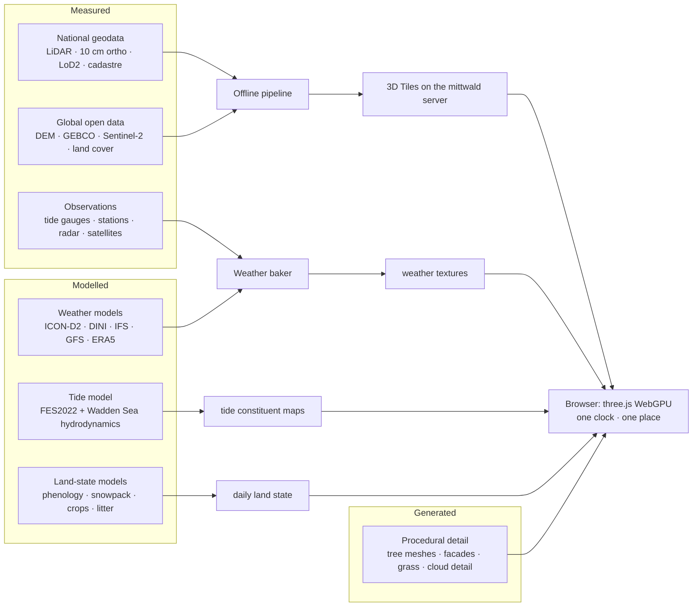

# Living Earth – plan for a digital-twin Earth simulation

*Status: researched October 2026. **Milestones M0–M3 built on 31 Oct 2026** (foundations; the whole Earth
from a distance; hero terrain & imagery; buildings) – the `earth` simulation runs behind the
work-in-progress flag (`#/sim/earth`); outcomes, measurements and deviations in
[12 §1.1–1.4](12-roadmap-verification-licences.md#11-m0-outcome-31-oct-2026). Open from M1–M3: the tide
overlay (→ M5), the Danish orthophotos, point cloud and BBR (tokens), baked tilesets on the mittwald server,
facade/roof photos. M4 (vegetation) is next.*

A new simulation for Living Planet 3D: **the real Earth, zoomable from space down to the
ground**. Real terrain, real satellite and aerial imagery, a real sea floor revealed when
the water is drained, real tides (*Ebbe und Flut*), clouds and weather that match the
observations, wind, shadows, seasons, snow, leaves changing colour and lying on the
ground. The whole planet at globe scale, and **two places with every detail in true 3D**:

- **Lübbecke** (NRW, Germany) – a small town at the foot of the Wiehengebirge ridge:
  beech forest with large bark-beetle clearings on the ridge, farmland and the
  Mittellandkanal in the lowland, a raised bog.
- **Fanø** (Denmark) – a Wadden Sea island: a vast sand beach, dunes, heath, a dune pine
  forest, salt marsh and tidal flats that fall dry twice a day, thatched villages.

## Contents

| # | File | What it covers |
|---|---|---|
| 01 | [Architecture](01-architecture.md) | engine decision (three.js WebGPU + 3d-tiles-renderer), precision, LOD ladder, streaming budgets, render graph, Google 3D Tiles position |
| 02 | [Global data](02-data-global.md) | terrain, bathymetry, imagery, land cover, canopy height, buildings, snow & ice, geoid – for the whole Earth |
| 03 | [Lübbecke data](03-data-luebbecke.md) | NRW open geodata, LiDAR, LoD2, orthophotos, fields, forests, water, DWD |
| 04 | [Fanø data](04-data-fanoe.md) | Danish geodata, sea floor, tides & surges, DMI weather/ocean models, BBR, nature, AIS |
| 05 | [Terrain, ground, buildings, hero spots](05-terrain-imagery-buildings.md) | from orthophoto to living material, LoD2 + facades, small objects, Gaussian splats |
| 06 | [Vegetation & seasons](06-vegetation-seasons.md) | every tree from LiDAR, species, procedural models, phenology, crops, leaf litter |
| 07 | [Water, tides, sea floor](07-water-tides-seafloor.md) | FFT ocean, shoreline, Wadden Sea tide model, flats falling dry, draining the ocean |
| 08 | [Atmosphere, weather, clouds](08-atmosphere-weather-clouds.md) | ephemeris, sky, NWP + satellite + radar fusion, volumetric clouds, wind, rain, shadows, lights |
| 09 | [Snow, ice, winter](09-snow-ice-winter.md) | snowpack model, 1 m downscaling, snow rendering, frost, ice on lakes and the Wadden Sea |
| 10 | [Time, UI, interaction](10-time-ui-interaction.md) | the simulation clock (live/replay/forecast/climatology), panel, camera, picking, module layout |
| 11 | [Pipeline & hosting](11-pipeline-hosting.md) | offline data pipeline, formats, data volumes, hosting on the mittwald server, scheduled weather jobs |
| 12 | [Roadmap, verification, licences](12-roadmap-verification-licences.md) | milestones M0–M9, check scripts, reference devices, risks, licence & attribution matrix (all checks done) |
| 13 | [Data requests](13-data-requests.md) | accounts to create, and step-by-step requests with email templates for the Wadden Sea surveys and two licence confirmations |

## The idea in one picture

Every pixel is one of three kinds – **measured**, **modelled** or **generated** – and a
display toggle tints the world by which kind it is. "Absolutely accurate" is defined per
subsystem (see the accuracy targets at the top of files 06–09) and checked against
observations ([12 §2](12-roadmap-verification-licences.md#2-verification-keep-the-repos-scriptscheck-mjs-culture)).

## Key decisions

1. **Engine**: three.js r187+ `WebGPURenderer` (TSL, automatic WebGL2 fallback) +
   `3d-tiles-renderer` for streaming + `@takram/three-atmosphere/webgpu` for the sky;
   own TSL passes for clouds, ocean, tides, vegetation and snow. Keeps the app's stack;
   gives compute shaders. ([01](01-architecture.md))
2. **Open data first**. Everything in the default build is open data that may be cached
   and redistributed. Commercial layers (Google Photorealistic 3D Tiles – blocked for
   EEA billing accounts anyway –, Esri, Mapbox) are at most an opt-in with the visitor's
   own key. ([02](02-data-global.md), [01 §6](01-architecture.md#6-google-photorealistic-3d-tiles-optional))
3. **The hero areas are built, not streamed from a vendor**: NRW and Danish open data
   (1 m / 0.4 m terrain, 10–12.5 cm orthophotos, 8+ pts/m² LiDAR, LoD2 / reconstructed
   LoD2, field and nature registers) through our own pipeline into 3D Tiles on the
   mittwald server (≈ 4–7 GB per area). ([03](03-data-luebbecke.md), [04](04-data-fanoe.md), [11](11-pipeline-hosting.md))
4. **Weather is data-driven**: NWP 3D cloud fields (GFS globally, ICON-D2 and DINI
   locally, ERA5 for the past) placed by satellite cloud masks and radar, rendered by a
   Nubis-style raymarcher. Individual small clouds are generated consistent with the data.
   ([08](08-atmosphere-weather-clouds.md))
5. **Tides are modelled properly for Fanø**: an offline hydrodynamic model of the Grådyb
   basin baked into constituent maps + live surge from DMI gauges; FES2022 globally.
   ([07](07-water-tides-seafloor.md))
6. **The land remembers**: snow, leaf state, litter, crop stage and wetness are integrated
   from daily drivers, not keyed to the calendar. ([10 §1.4](10-time-ui-interaction.md#14-history-dependent-state-the-land-remembers))
7. **Every tree is a real tree** in the hero areas (LiDAR-detected, species-assigned,
   procedurally modelled, seasonally animated). ([06](06-vegetation-seasons.md))
8. **Accuracy is tested** like the other simulations: pure-JS models with `check-earth-*`
   scripts against ephemerides, tide gauges, phenology and snow observations.

## What is real at each zoom level

| View | Outside the hero areas | Lübbecke / Fanø |
|---|---|---|
| Space | real seasonal imagery, today's clouds from satellites and models, snow & sea ice of the day, night lights | same |
| 100 km | 30 m terrain, 10 m Sentinel-2 by season, volumetric clouds from the NWP | same |
| 1 km | best open imagery (national orthophotos where open), procedural buildings (OSM/Overture) and forests (land cover + canopy height) | 10–12.5 cm imagery, 1 m / 0.4 m terrain, every building, every tree |
| Street level | procedural – marked as such | measured geometry + generated detail (facades, grass, leaves), real tides, flats, snow patterns, splat-captured hero spots |

## Milestones (summary)

M0 foundations → **M1 the whole Earth from a distance** → M2 hero terrain & imagery →
M3 buildings → M4 vegetation → M5 water & tides → M6 weather → M7 seasons & snow →
M8 hero spots → M9 polish. M0 ends with a **WebGPU go/no-go**
([01 §1.4](01-architecture.md#14-fallback-architecture)). Total ≈ 12–20 months of focused
work for one developer; M0–M3 are the proposed first release. Details, exit criteria and
effort in [12](12-roadmap-verification-licences.md#1-milestones).

## Decisions

Taken by the project owner (31 Oct 2026):

1. **Hosting**: tiles, weather textures and the scheduled jobs run on the owner's
   **mittwald** server ([11 §5–6](11-pipeline-hosting.md#5-hosting--the-mittwald-server)).
2. **EOX Sentinel-2 cloudless** (CC BY-NC-SA 4.0) is used for mid-zoom imagery – the
   project is open source and non-commercial ([02 §9](02-data-global.md#9-recommended-open-default-stack-summary)).
3. **Data requests** for the Wadden Sea surveys are prepared as a step-by-step guide with
   email templates ([13](13-data-requests.md)).
4. **No drone capture**: aerial detail comes from the official 10–12.5 cm products;
   eye-level detail is procedural/LoD3, with optional ground-level capture
   ([05 §5](05-terrain-imagery-buildings.md#5-hero-spots-photogrammetry-and-gaussian-splats)).
5. **Scope of v1**: people, cars, animals and interiors are out
   ([12 §4](12-roadmap-verification-licences.md#4-out-of-scope-for-the-first-version)).

Licences of every dataset were checked at the source; the outcome is in
[12 §5](12-roadmap-verification-licences.md#5-licence--attribution-matrix). Two need a
written confirmation (Danish field parcels and AIS) – both have a fallback, and the
emails are in [13](13-data-requests.md).
